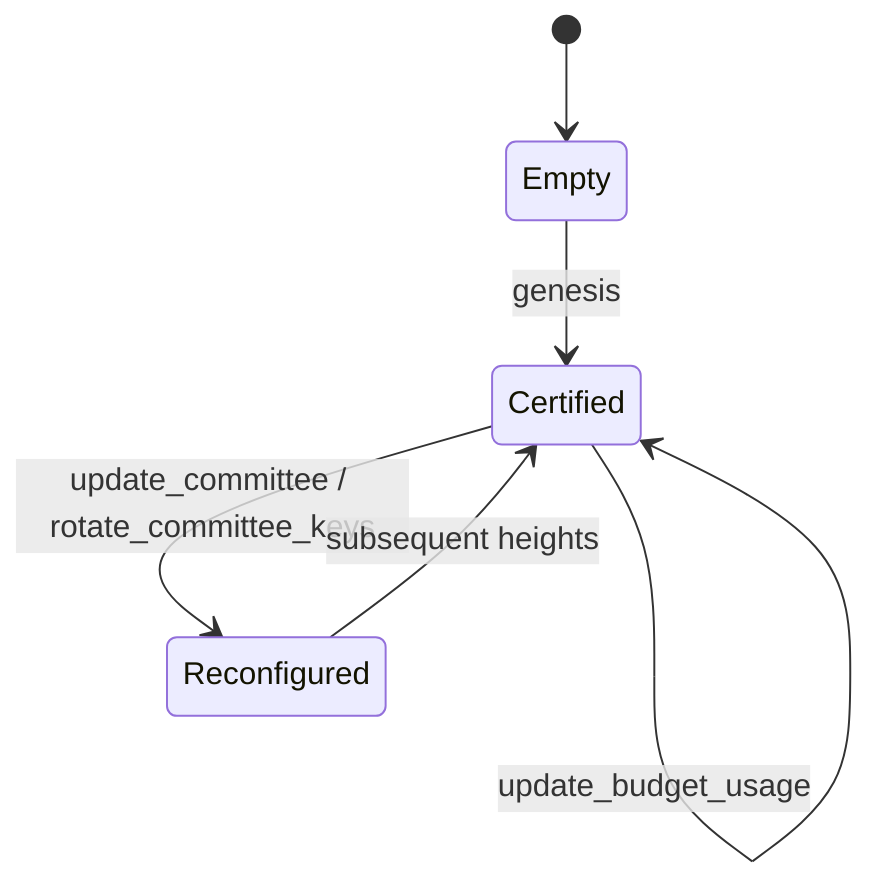

# NetP2P 架构设计

## 设计边界

NetP2P 是一个可管理的去中心化 overlay 网络。项目使用 `github.com/libp2p/go-libp2p` 作为唯一网络栈：

- 身份使用 libp2p `PeerID`；
- 地址与拨号使用 multiaddr 和 swarm；
- 传输默认使用 QUIC，也可按平台能力回退到 TCP/WebSocket；
- 加密、stream 复用、NAT traversal、relay、DHT 和 gossipsub 均由 libp2p 提供；
- 不使用 WireGuard 作为传输层或加密层；
- TUN 只作为可选的操作系统 VPN 接入层，不是底层传输协议。

项目不兼容 NetBird Management API。NetBird 只作为管理模型参考。

## 协议

| 协议 | 用途 |
| --- | --- |
| `/netp2p/control/login/2.0.0` | 提交身份、OIDC JWT/setup key 与设备信息 |
| `/netp2p/control/sync/2.0.0` | 请求 certified snapshot 与增量同步（含 admission 摘要） |
| `/netp2p/control/state-update/2.0.0` | 分发 proposal、vote、QC、snapshot 与 catch-up 交换 |
| `/netp2p/control/admin/2.0.0` | 带凭证的 state transition 提交（CLI / Web 共用一处鉴权） |
| `/netp2p/web-api/2.0.0` | 浏览器控制台的 HTTP-over-libp2p API |
| `/netp2p/presence/2.0.0` | committee 之间交换观测在线状态（非认证） |
| `/netp2p/link/probe/2.0.0` | 采集 RTT、丢包、抖动、带宽估计与路径能力 |
| `/netp2p/link/gossip/2.0.0` | manager mesh 交换签名的链路观测 |
| `/netp2p/data/frame/2.0.0` | 传输 overlay frame 或服务流量（二进制分帧，含 via-manager 信封） |
| `/netp2p/data/quota/2.0.0` | 上报聚合用量（增量），不逐包上报 |

协议版本由 `internal/version.ProtocolVersion` 统一决定，并嵌入每个协议 id。控制面 payload 是 protobuf（`proto/netp2p/v1`，`internal/wire` 负责领域模型 ↔ protobuf 转换），数据面帧保持紧凑二进制。高版本协议通过 libp2p multistream negotiation 与 capability exchange 兼容：版本不一致时显式拒绝连接（见 `docs/upgrade.md`）。

## 控制面

普通 client 不参与共识。Manager 是一个 BFT committee，建议初始容错为 `n = 3f + 1`：

1. client、admin API 或 IdP 同步产生 proposal；
2. proposal 进入 committee decision log；
3. committee 对 state transition 达成 BFT 共识；
4. 共识结果生成 monotonically increasing `epoch` 和 certified snapshot；
5. snapshot 由 committee threshold signature 或 aggregator signature 签名后分发；
6. client 验证 signer/quorum proof 后替换本地 network map。

Policy、group、peer、route、quota、committee membership 的变更都是 state transition。Cold start 使用 bootstrap manager 或静态 committee 配置发布第一个 network genesis state。

Client 保留最近 certified snapshot。Manager 短暂不可用时继续使用已有策略；manager 恢复后通过 epoch 与 decision log 追平状态。

### v0 实现

当前代码实现固定 `n = 4, f = 1` 的 HotStuff-lite committee：

- 每轮由 `leader = committee[(height + round) % n]` 发起 proposal；proposal 携带完整 `NetworkState`；
- committee 成员用 BLS12-381 密钥分片对 `state_hash` 与 `transition_hash` 签名，`2f + 1 = 3` 个分片聚合为 `QuorumCertificate`（`AggregateSignature` + `SignerBitmap` + `CommitteeEpoch`）；
- commit 生成 `SignedSnapshot{epoch, height, stateHash, state, committee, committeeConfig, qc}`；
- client 用 `ValidateSnapshot` 校验 state hash、聚合签名（群公钥 pairing）、`SignerBitmap` 中 ≥ threshold 的贡献者、epoch 一致性与 leader 一致性；
- committee 成员之间通过 `/netp2p/control/state-update/2.0.0` 交换 proposal、vote、QC 和 snapshot；
- 冷启动由静态 seed 描述 committee，height-1 leader 提交 genesis。

`StateHash`/`TransitionHash` 使用 deterministic protobuf（`proto.MarshalOptions{Deterministic: true}`）计算，替代旧的 canonical JSON，保证跨进程、跨二进制一致且不受字段顺序或 HTML 转义影响。

**BLS 阈值签名**：`internal/crypto/bls` 从网络 seed + `CommitteeEpoch` 确定性派生 Shamir 分片（t=3, n=4），群公钥写入 `CommitteeConfig`。Ed25519 继续承担 libp2p PeerID 与传输身份；BLS 只用于共识投票与 QC。任何 3 个分片可聚合验证，2 个不能。

**Committee 重配置**：`update_committee` 可在一次 transition 内替换最多 `f = 1` 个成员（必须保留至少一个 forwarding 成员，新成员需合法 PeerID/地址/BLS 公钥）；`rotate_committee_keys` 递增 `CommitteeEpoch` 并重新派生分片。commit 时先记录签名所用 committee，再原子替换，保证旧 epoch 的投票与新 epoch 的快照都被正确拒绝/接受。v0 规模固定为 4，不允许改变 committee size。

### Catch-up 与 View Change

- `Engine.CatchUp(snapshot)` 允许重启/落后的 manager 从任意 peer 的 certified snapshot 直接 commit，无需本地 proposal。
- `CommitteeMesh.CatchUp(ctx)` 在 manager 启动后主动向所有 peer 发送 `sync_request`，等待第一个有效 `sync_response` 并 CatchUp。
- `Submit` 在 round 超时（2s）后轮换到下一个 round 的 leader，最多轮换 `n` 次。一个 leader 宕机时最多浪费一轮，committee 不停摆。
- `Engine.Snapshot(height)` 和 `Engine.LatestSnapshot()` 提供 decision log 查询接口。

### Admin 管理面

libp2p 协议 `/netp2p/control/admin/1.0.0` 接受带静态 token 的 `StateTransition`（upsert/remove group、policy、route、budget、setup key）。Manager 验证 token 后经 BFT Submit 认证，返回 certified snapshot。CLI 通过 `netp2pd --role admin` 提交。

### 权限模型（角色 × 模块 × 操作）

所有控制面写操作都经过同一套矩阵 `internal/auth`，Web 控制台与 admin CLI 共用：

| 角色 | 权限 |
| --- | --- |
| `owner` | 全部模块全部操作 |
| `admin` | peers/groups/policies/routes/dns/nameservers/setup_keys/budgets 全操作；users 读+建+改（不可删）；settings/events/presence 只读 |
| `network_admin` | 同 admin，但 users 只读 |
| `auditor` | 全部模块只读 |
| `usage_viewer` | budgets/events/presence 只读 |
| `user` | 仅 peers（限定自己的设备）与 settings 只读 |

`StateTransition` 通过 `auth.TransitionPermission` 映射到 `(module, operation)`，`upsert_*` 需要 `update`，`remove_*` 需要 `delete`，用户类 transition 映射到 `users`。静态 admin token 是 break-glass 凭证，映射为 `owner`。

### 去中心化 Manager 的登录

- SSO peer 的登录由 manager 校验 JWT 后转成 `register_user`（首次）或 `update_user_groups`/`update_user_role`（变化时）transition，再提交 `register_peer`；peer 的 groups 由 `setupKey.groups ∪ user.autoGroups` 决定。
- 登录过期由 `NetworkSettings.LoginExpirationDays` 决定。token 的 `iat` 晚于 `peer.LastLogin` 视为重新认证，刷新窗口；否则超过窗口返回 `Code=login_expired`，client 自动重跑 device flow。
- 为了防止决策日志被每次 keepalive 撑爆，`LastLogin` 只在距上次记录超过 12 小时时重写一次。

## Group、Policy 与 Network Map

Group 是稳定授权标签，可包含 user、device peer、route peer 和 service。SSO claims 不直接写入 policy，而是映射为 managed groups。

Policy 表达 source 与 destination 之间的关系：

```text
Policy {
  id
  source_groups
  destination_groups
  services { protocol, start_port, end_port }
  effect: allow | deny
  direction: unidirectional | bidirectional
  posture_requirements
  link_constraints
}
```

Deny 优先于 allow。Peer membership 或 user group membership 变化后，manager 重新编译 policy，并为每个 peer 生成最小 NetworkMap。

## 路由与链路选择

Manager 下发候选与约束，peer 根据本地探测结果选择路径：

- direct path：libp2p hole punching 后的直连；
- relay path：libp2p circuit relay；
- multi-hop path：受信 overlay relay/gateway 组合；
- exit path：提供受限外网访问的 gateway。

路径不是简单“P2P 优先、relay 兜底”。每个候选路径维护 `LinkProfile`：

```text
LinkProfile {
  path_id
  path_type
  next_peer
  rtt
  loss
  jitter
  bandwidth_estimate
  stability
  congestion
  relay_cost
  public_relay
}
```

路径评分按 flow class 计算：

- 延迟敏感：RTT、抖动、拥塞权重高；
- 吞吐敏感：带宽、丢包恢复能力权重高；
- 成本敏感：relay 成本、公网 relay、配额消耗权重高；
- 高可靠：要求热备路径与快速切换。

Manager 可通过 link constraints 禁止付费 relay、限制最大路径长度、指定 gateway 或要求热备。最终 path decision 留在 peer，减少探测上报和切换延迟。

## TrafficBudget

TrafficBudget 是 committee 维护的权威状态：

```text
TrafficBudget {
  subject: peer | user | group | route | service
  daily_bytes
  monthly_bytes
  peak_bps
  burst_bytes
  relay_cost_limit
  on_exhausted: block | throttle | degrade | switch_path
}
```

Peer/relay/gateway 聚合用量后通过 quota protocol 上报。本地执行器在运行时扣减 token/byte bucket；committee 周期性合并用量并发布新的 certified quota state。

## SSO 同步

支持 OIDC authorization code + PKCE 和 device authorization flow：

1. peer/device 用 device flow，或浏览器用 PKCE；两者都拿到 IdP 的 ID token；
2. client 通过 libp2p login stream 提交 JWT；
3. manager 用 `github.com/coreos/go-oidc/v3` 校验 issuer、audience、RS256 签名、expiry 与 JWKS；
4. manager 从 `groups` claim 映射到 managed groups，`adminGroups` 命中即提升为 `admin`；
5. membership 变化触发 policy 编译和 NetworkMap 重新发布；
6. certified signed state 通过 sync stream 下发。

Setup key 是无人工交互设备的引导凭证，必须有 scope、expiry、使用次数和撤销状态。

### v0 实现

- **peer device flow**：`netp2pd --role client --sso --sso-issuer … --sso-client-id …` 调用 `oauth2.Config.DeviceAuth`，把 verification URI 与 user code 打印到 stderr，然后 `DeviceAccessToken` 轮询直到拿到 ID token，再以该 token 登录；收到 `login_expired` 时自动重跑 device flow。
- **浏览器 PKCE**：`GET /auth/login` 由 manager 生成 verifier/challenge 并 302 到 IdP；`GET /auth/idp/*` 是 manager 到 issuer 的反向代理（实验室 IdP 的 hostname 只在内网可解析时也可用）；`GET /auth/callback` 用 code + verifier 换取 ID token，再 302 到 `/#id_token=…`。片段不会发给服务器，token 只留在浏览器内存。
- **用户与组**：`register_user` 由首次登录创建；`jwt-<claim>` 组在 claim 首次出现时创建（`Issued=jwt`、`SSOClaim=<claim>`），JWT 组不能被手工删除；`update_user_groups` 会同步 `Group.UserIDs`/`Group.PeerIDs` 与 `PeerRecord.Groups`。
- **角色**：`roleClaim` 优先，其次 `adminGroups` 命中为 admin，首个登录用户为 owner，其余为 user。IdP 角色是建议性的：不放行「降级最后一个 owner」这类被 certify 规则拒绝的变更，也不会因此让用户登录失败。
- **登录过期**：见上一节的 `LoginExpirationDays` 规则。
- **测试用 IdP**：`internal/oidctest` 提供 discovery/JWKS/device flow/authorization code 的最小实现，`cmd/netp2p-mockidp` 是 Docker 用的薄封装（device flow 自动批准，浏览器用独立 subject）。

## DNS

certified state 中的 `Nameserver` / `DNSZone` / `DNSSettings` 由 manager 下发，client 端 `internal/dns` 在本地监听（默认 `127.0.0.1:53`）：

- 先查 certified zones 的 A 记录，再查自动注册的 peer 名 `<dnsLabel>.<settings.dnsDomain>`（`PeerRecord.DNSLabel` 在注册时确定性分配，冲突追加后缀）；
- 其余查询按 `MatchDomains` 转发到对本 peer 生效的 certified nameserver，没有匹配则回退到接管前的 host resolver；
- zone / nameserver 的 `Groups` 与 `DNSSettings.Groups` 按 peer 的 group 过滤；
- 启用 TUN 且允许时接管 `/etc/resolv.conf`（原文件备份到 `/etc/resolv.conf.netp2p.bak`，SIGTERM/SIGINT 恢复），`--no-dns` / `--dns-manage-resolv-conf=false` 可关闭。

## 数据面

overlay frame 建立在 libp2p secure stream 上。数据面通过一个统一的 `PacketSink` 接口接入操作系统：

- **TUNPacketSink（Linux 默认）**：`/dev/net/tun` + `TUNSETIFF` 创建 `netp2p0`，配置 overlay 地址与 MTU 1280，并把所有 peer 的 `/32` 路由指到该设备。内核对 ICMP 直接应答，不再需要用户态合成。需要 `NET_ADMIN` 与 `/dev/net/tun`，缺失时显式告警并回退 userspace。`--no-tun` 强制 userspace。
- **UDPPacketSink（兼容模式）**：在本地 `127.0.0.1:51820` 监听 UDP，收发 length-prefixed IPv4 packet。不需要 TUN 或 `NET_ADMIN`，可在 WSL、CI 和容器内运行；`netp2p-probe` 用于替代系统 `ping`。

当前 v0 数据流：

1. 本地 endpoint 收到 IPv4 packet，按目标 overlay IP 查找 `PeerRecord`；
2. 先用 conntrack flow 判断是否为已放行连接的回复；否则用 certified state 对 source→destination 方向执行 policy，允许则经 `/netp2p/data/frame/1.0.0` 发给对端；
3. 接收端校验 `RemotePeer()`、source overlay IP、目标为本机 overlay IP，再走同样的 flow → policy 判定；
4. userspace 模式下，若收到 ICMP echo request，接收端生成 echo reply 并经 frame stream 发回请求方；TUN 模式交给内核。

Flow 表（`internal/conntrack`）使「请求方向被 allow、回复方向被 deny」的连接仍能工作：reply 只需匹配一个本机已观测过的 flow，不必要求镜像 policy。

数据面不再每包开一条 stream，也不再使用 JSON/base64：`internal/transport.FrameConn` 为每个远端 peer 维持一条长连接，二进制分帧为 `4 字节大端长度 + payload`，写入走有界发送队列（默认 1024，满则按 flow 丢弃并计数），断开后指数退避重连（250ms 起，上限 5s）。控制协议（login/sync/admin/presence/web）继续使用 `Envelope{protocol, payload}` JSON。

加密与完整性由 libp2p secure channel 保证，不需要在 frame 层重复加密。

## 多跳路径与配额

**多跳规划**：`internal/link/planner.go` 枚举简单 manager 路径（不重复 hop，候选上限 128），`internal/path.Score` 按当前的 flow class 加权 RTT/loss/带宽/成本，`RouteAssignment` 记录 primary 与有序 fallback、`MaxHops`，每个 `PathSpec` 记录 `ManagerHops`（PeerID 列表，首末段为 access 段）与累加 `Cost`。BFT 校验 hop 必须是有 forwarding 能力的 committee 成员、无重复 hop、hop 数不超过 `MaxHops`。客户端严格按 certified primary → fallback 顺序发包，manager 按上一跳身份校验后逐跳转发，目标客户端校验来源与 policy。探测指标是非认证观测；只有 planner 输出经 BFT 认证。

**配额**：`internal/quota` 的 `TokenBucket` 做真实限速（rate + burst），`Enforcer` 按 route → group → peer 优先级解析预算（同优先级取最具体匹配，`block` 优先于其它动作），动作语义为 `block` / `throttle`（有界延迟，上限 250ms）/ `degrade` / `switch_path`。客户端在出方向准入，manager 在转发方向按源 peer/assignment 准入并做 per-peer 有界队列与 backpressure。用量以增量经 `/netp2p/data/quota/2.0.0` 上报（默认 30s 或累计 64KB 触发），manager 聚合后经 `update_budget_usage` 写入 certified `TrafficBudget.UsedDailyBytes/UsedMonthlyBytes`，提交频率硬上限 60s 一次，避免共识 churn。日/月重置由 certified 时间戳驱动，跨 manager 确定性一致。

## 可观测性

- `internal/metrics`（Prometheus）暴露 BFT height/commits/rejected、转发 forwarded/dropped、同步请求、配额 block、certified peers、link segments 与最低置信度；`--metrics-listen` 在独立端口提供 `/metrics`，默认关闭。
- Web API 提供 `/api/v1/events`（认证决策日志，含 signer bitmap 与 epoch）、`/api/v1/diagnostics`（人类可读健康快照）、`/api/v1/assignments`（certified assignment + 本地 admission 观测）、`/api/v1/quota`。
- 审计事件由每次 commit 的 transition + leader + signer bitmap 派生，Web Activity/Diagnostics 页展示。

## State transition 图



**Schema 版本策略**：protobuf schema 位于 `proto/netp2p/v1/`，生成的 `.pb.go` 提交入库，使 `go build ./...` 无需 protoc；`make proto` 幂等。schema 不兼容变更必须同时递增 `internal/version.ProtocolVersion` 并整体升级 committee（v0 无跨版本兼容，见 `docs/upgrade.md`）。
